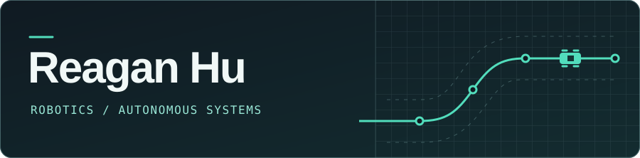

I'm an Engineering Science student at the University of Toronto interested in **AI robotics**. I’m especially interested in how to evaluate robot training data and how those evaluations can guide what we use to train models.

**[Portfolio ↗](https://reagan-hu.vercel.app/)**

## Current work

**Simulation Lead · [aUToronto](https://www.autodrive.utoronto.ca/our-team)**  
I build simulation and validation tools for path planning and vehicle controls so the team can test driving scenarios before running them on the car.

## Recent research

**AI Robotics Engineer Intern · [Acceleration Consortium](https://reagan-hu.vercel.app/#experience)**  
In the AI & Automation Lab, I built a pipeline that combined learned policies, visual servoing, and scripted skills for multi-step robot tasks. I also contributed to infrastructure for fine-tuning vision-language-action models in simulation and on real robots.
